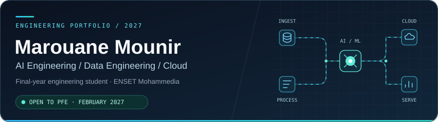

## About me

I'm a final-year **Big Data & Cloud Computing engineering student at ENSET Mohammedia, Morocco**, with internship experience in Generative AI and software engineering at Capgemini and full-stack development at NTT DATA.

I enjoy building end-to-end systems that connect data pipelines, intelligent applications and cloud infrastructure. My current focus is on LLM-powered applications, multi-agent systems, retrieval-augmented generation (RAG) and scalable data architectures.

**Currently seeking a final-year engineering internship (PFE 2027)** in AI Engineering, Data Engineering or Cloud & DevOps.

## Selected projects

| Project | What it does | Core technologies |
| :--- | :--- | :--- |
| [InterviewAI](https://github.com/Marouanemounir/interview-ai-platform) | Multi-agent technical interview simulation with real-time voice and retrieval-based evaluation. | LangGraph, FastAPI, Next.js, Qdrant |
| [EduTrack Analytics](https://github.com/Marouanemounir/edutrack-analytics) | Academic analytics lakehouse with automated bronze, silver and gold data pipelines. | Apache Airflow, Delta Lake, PostgreSQL |
| [Taawun Maroc](https://github.com/Marouanemounir/Taawun-Maroc) | Multilingual, multi-agent humanitarian coordination platform for disaster relief. | Gemini API, React, Node.js |
| [Azure CI/CD Pipeline](https://github.com/Marouanemounir/azure-devops-cicd-pipeline) | Container delivery pipeline with passwordless cloud authentication. | Azure Container Apps, Docker, GitHub Actions, OIDC |
| [CloudRetail AWS](https://github.com/Marouanemounir/CloudRetail-AWS-Platform) | Cloud-native analytics API and infrastructure-as-code portfolio prototype. | Terraform, AWS ECS, RDS, FastAPI |
| [AI Systems Benchmark Lab](https://github.com/Marouanemounir/AI-Systems-Benchmark-Lab) | Offline ML experimentation and prompt-routing research prototype. | Python, scikit-learn, pytest |

[Explore all public repositories →](https://github.com/Marouanemounir?tab=repositories)

## Experience

| Organization | Experience | Focus |
| :--- | :--- | :--- |
| **Capgemini Morocco — LabIA** | Generative AI Intern · 2026 | Applied LLMs and intelligent solutions |
| **Capgemini Morocco** | Software Engineering Intern · 2025 | Spring Boot, Angular, MySQL |
| **NTT DATA Morocco** | Full-stack Development Internship · 2025 | Spring Boot, Angular, PostgreSQL, Docker |

## Engineering toolkit

| Domain | Technologies |
| :--- | :--- |
| **AI & Machine Learning** | Python · LangChain · LangGraph · RAG · LLMs · Qdrant · ChromaDB · scikit-learn · TensorFlow |
| **Data Engineering** | SQL · Apache Spark · Kafka · Airflow · Hadoop · Delta Lake · Pandas |
| **Cloud & DevOps** | AWS · Azure · Oracle OCI · Docker · Kubernetes · Terraform · Jenkins · GitHub Actions · n8n |
| **Software Engineering** | Java · Spring Boot · FastAPI · REST APIs · Angular · React · Next.js · TypeScript |
| **Databases** | PostgreSQL · MySQL · MongoDB |

<picture>
  <source media="(prefers-color-scheme: dark)" srcset="https://skillicons.dev/icons?i=python,java,ts,fastapi,spring,react,nextjs,angular,postgres,mongodb,aws,azure,docker,kubernetes,terraform,githubactions,git,linux&amp;theme=dark&amp;perline=9"/>
  
</picture>

## Achievements & credentials

- **3rd place** — ENSET Challenge Hackathon 2026
- **Google Developer Competition** — Taawun Maroc multi-agent AI project
- **Oracle Cloud Infrastructure** — AI Foundations and Foundations
- **AWS Academy Cloud Foundations**
- **MongoDB** — Introduction to MongoDB

## GitHub activity

<picture>
  <source media="(prefers-color-scheme: dark)" srcset="https://github-readme-stats.vercel.app/api?username=Marouanemounir&amp;show_icons=true&amp;theme=github_dark&amp;hide_border=true"/>
  
</picture>
<picture>
  <source media="(prefers-color-scheme: dark)" srcset="https://github-readme-stats.vercel.app/api/top-langs/?username=Marouanemounir&amp;layout=compact&amp;theme=github_dark&amp;hide_border=true"/>
  
</picture>

<picture>
  <source media="(prefers-color-scheme: dark)" srcset="https://streak-stats.demolab.com?user=Marouanemounir&amp;theme=github-dark-blue&amp;hide_border=true"/>
  
</picture>

---

**Interested in building intelligent, reliable systems together?**

[Connect on LinkedIn](https://linkedin.com/in/marouane-mounir) · [Get in touch](mailto:mounirmarwane4@gmail.com)

